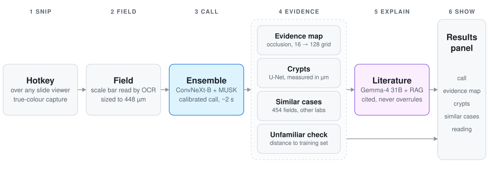

# gutfeeling

**A calibrated second read for sessile serrated lesion (SSL) vs hyperplastic polyp (HP)**, one of pathology's least
reproducible calls. Press a hotkey over any slide viewer, snip one field, and get a call matched to a 7-pathologist
consensus in about 2 seconds, with the evidence behind it.

Ashby Prize Hackathon 2026 · Aiden Wang, Alice Yu, Ahaan Verma · Research tool, not for diagnosis.

[](https://youtu.be/q3kmF1mwB1Q)

**[Watch the demo](https://youtu.be/q3kmF1mwB1Q)**

## Why

There is no clean ground truth for SSL vs HP. On MHIST, two pathologists agree only **73%** of the time and all seven
agree on just **34%** of fields. SSLs are precancerous, so a missed one can change a patient's follow-up interval.
gutfeeling learns the pathologists' consensus, says how confident it is, and shows why.

## Results at a glance

On the 977 official MHIST test images, scored once with the exact models the app runs:

| | gutfeeling | Best published result that never used the test split (Virchow2, linear probe) | General vision LLM (Gemma-4 31B) |
|---|---|---|---|
| **Balanced accuracy** | **0.888** | 0.848 | 0.554 |
| AUC | 0.956 | | |
| SSL caught / HP cleared | 89.2% / 88.5% | | 96.4% / 14.4% |
| Calibration error | 2.2% | 0.6% | |

- **The ceiling:** a single pathologist matches the 7-pathologist majority 83% of the time. About 1 in 6 test tiles is a 4-3 split, which caps any model at roughly 89-92% agreement, so gutfeeling's 0.887 accuracy is at that ceiling.
- **The app matches the reported result:** the test images sent through the app as screen snips give 0.886.
- **Outside data:** gutfeeling was never trained on other hospitals' slides. On them it keeps HP right (99.6% on UniToPatho) but under-calls SSL ([other labs](docs/other_labs.md)).

Full tables, the comparison with every published MHIST result, and how each protocol differs are in [results](docs/results.md).

## What you see

| | |
|---|---|
| **The call** | A ConvNeXt-Base + MUSK ensemble, fine-tuned on pathologists' votes and calibrated. The displayed score puts the decision line at 50% |
| **Evidence map** | Which parts of the field pushed the call toward SSL or HP. Each region is blurred out in turn and the score change is recorded. Faithful by deletion test: 4.5x a random region |
| **Crypts** | Outlined by a U-Net, measured in microns, and labelled dilated or round and regular (F1 0.36 → 0.91 vs rule-based detection on expert outlines) |
| **Similar cases** | The 3 nearest labelled SSL and HP fields from other labs (454 reference fields) |
| **Literature reading** | An LLM explains the call from what was measured and from retrieved literature excerpts, with citations. It never sees the image and never overrules the image models |
| **Unfamiliar-input warning** | Flags fields unlike anything in training, such as photos or other stains |

## How it works

<picture>
  <source media="(prefers-color-scheme: dark)" srcset="docs/img/pipeline_dark.svg">
  
</picture>

- **App:** Electron (snip screen, results panel) talking to a Python FastAPI service on port 8765, which streams results as each stage finishes.
- **Models:** ConvNeXt-Base (88M parameters, fully fine-tuned) and MUSK (305M; LoRA rank 8 on all 24 layers). Training used 5-fold cross-validation, soft labels (share of the 7 pathologists who said SSL), class balancing and Platt calibration. Every choice was made on training data; the test split was scored once.
- **LLM:** Gemma-4 31B with retrieval over a curated literature library. Code checks every answer for invented citations, overclaiming and evidence that wasn't measured; confidence is capped at 92%, and the cleanest of 3 runs is shown.

More detail:
- [How it works](docs/how_it_works.md): each stage, and the design decisions behind it
- [The model](docs/model.md): data, candidates, training recipe, and how the ensemble was chosen
- [Supporting analyses](docs/analyses.md): what was tested and dropped, including stain normalisation, test-time tweaks and field size

## Using it

```bash
cd app
npm install
npm start
```

The app runs in the background and starts the Python backend with it.

1. Over any slide viewer (QuPath, a web viewer, an image), press **Ctrl+Shift+Space**.
2. Click or drag to place the field. If the viewer shows a scale bar, the field is exactly 448 um (one MHIST field); otherwise it is the largest square that is mostly tissue.
3. Press **Enter**. The results open beside the field.

| Key | Action |
|---|---|
| Ctrl+Shift+Space | Snip the screen |
| Enter | Analyse the field |
| F | Focused view |
| Space (hold) | Hide everything the AI drew |
| Scroll / drag | Zoom and pan (up to 8x) |
| E / C / S | Exposure, contrast and saturation views (display only, never the call) |
| 0 / Esc | Reset view / close |

The **gear** sets the decision cut-off, with presets from "catch at least 95% of SSLs" to "clear at least 99% of HPs". The default is the balanced cut-off used in every reported result.

Models and data are not included; see [reproducing](docs/reproducing.md) for access and training commands.

## Limitations

- **One lab:** trained on MHIST only (Dartmouth). On other labs' slides it keeps HP right but under-calls SSL.
- **Single fields:** it reads one field at a time, not whole slides or clinical context such as polyp size or location.
- **Consensus, not truth:** the labels are a consensus of pathologists. Molecular markers such as BRAF would give a firmer reference, but no public SSL slides have them yet.
- **Not validated in practice:** no study yet of pathologists using it. It is a research tool, not a medical device.

## Repository

| Folder | Contents |
|---|---|
| [`app/`](app) | Electron app: snip screen, results panel, cut-off settings |
| [`backend/`](backend) | FastAPI service: `engine.py` (ensemble, evidence map, similar cases), `gland_net.py` + `glands.py` (crypts), `scalebar.py`, `region.py`, `llm.py`, `server.py` |
| [`research/`](research) | Training and evaluation scripts |
| [`docs/`](docs) | Detail pages and [result files](docs/results) |
| `papers/` | Literature library. `papers/library.json` is not distributed; build it from your own OpenEvidence answers with `research/build_library.py` |

## License

[PolyForm Noncommercial 1.0.0](LICENSE): free for any non-commercial purpose, including study, research, hackathon judging and demos. Commercial use needs permission. Third-party models and data (CONCH, MUSK, PLIP, ConvNeXt weights, MHIST, GlaS, UniToPatho, SPIDER, HunCRC, OpenEvidence content) are not included and keep their own terms.
